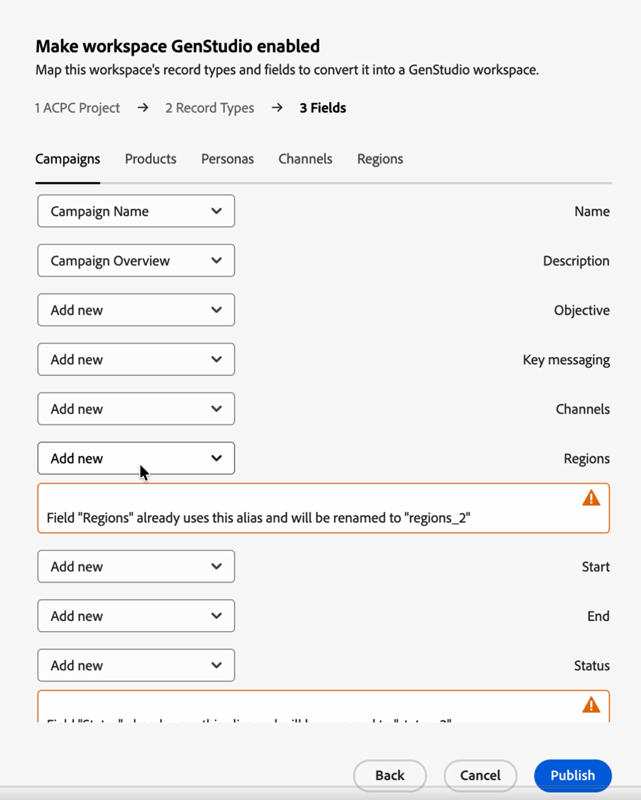

# Abilitare un&#39;area di lavoro di Workfront Planning in GenStudio for Performance Marketing

{{planning-important-intro}}

<!-- THIS IS HIDDEN FROM TOC-->

<!--
Better metadata, at publishing:
---
title: Promote a Workfront Planning workspace to GenStudio
description: The GenStudio for Performance Marketing workspace is available in Adobe Workfront Planning when your company has purchased both products and your instance of Workfront is integrated with your company's instance of GenStudio. You can promote a Workfront Planning workspace to GenStudio and have its information visible and updated from both systems.
role: User, Admin
author: Alina
recommendations: noDisplay, noCatalog
---
-->
Oltre a Workfront Planning, se la tua azienda ha acquistato anche Adobe GenStudio for Performance Marketing, l’area di lavoro GenStudio è disponibile in Adobe Workfront Planning quando l’istanza di Workfront viene integrata con l’istanza di GenStudio della tua azienda.

Se si dispone già di un&#39;area di lavoro in Workfront Planning, è possibile abilitarla per GenStudio anziché ricreare i dati.

L’abilitazione di un’area di lavoro la collega a un progetto di archiviazione Adobe e ne mappa i tipi di record e i campi sullo schema dell’area di lavoro GenStudio. Dopo aver completato la configurazione, puoi aprire i record dell’area di lavoro in GenStudio.

Considera i seguenti aspetti:

* È necessario avere accesso sia a Workfront Planning che a GenStudio for Performance Marketing.
* Per collegarti all’area di lavoro, devi disporre di un progetto di archiviazione cloud Adobe. L’amministratore dell’organizzazione può crearne una in Adobe Admin Console.

  Per informazioni, consulta [Gestire l&#39;archiviazione Adobe](https://helpx.adobe.com/it/business/enterprise/manage-storage-assets/manage-storage/manage-adobe-storage.html). <!--ensure this site still works-->

## Abilitare un&#39;area di lavoro di Workfront Planning in GenStudio

1. In Workfront Planning aprire l&#39;area di lavoro che si desidera abilitare.
1. Fai clic sul menu **Altro**  a destra del nome dell&#39;area di lavoro, quindi fai clic su **Abilita GenStudio**.

   La casella **Imposta come area di lavoro GenStudio** abilitata si apre con i seguenti passaggi:

   1. **Progetto ACPC**: seleziona il **Progetto ACPC** (progetto di archiviazione cloud Adobe) da sincronizzare con questa area di lavoro, quindi fai clic su **Avanti**. Gli utenti accedono all’area di lavoro in GenStudio tramite questo progetto.

      

   1. **Tipi di record**: associare i tipi di record dell&#39;area di lavoro ai sei tipi di record richiesti da GenStudio:

      * Campagne
      * Prodotti
      * Persone
      * Canali
      * Aree geografiche
      * Attivazioni

      Per ognuno, aprire l&#39;elenco e selezionare il tipo di record Planning corrispondente oppure selezionare **Aggiungi nuovo** per crearlo, quindi fare clic su **Avanti**.

      

   1. **Campi**: mappa i campi per ogni tipo di record. Utilizzare le schede nella parte superiore della finestra di dialogo per spostarsi tra i tipi di record. Per ogni campo, selezionare il campo Planning corrispondente oppure selezionare **Aggiungi nuovo** per crearlo.

      Ripetere l&#39;impostazione del campo per tutti i tipi di record.

      

   1. Rivedi e risolvi eventuali avvisi.

      Ad esempio, un nuovo campo può diventare il campo principale per il tipo di record oppure un alias di campo già in uso viene rinominato (se disponi già di un campo denominato &quot;Aree&quot;, quello importato potrebbe diventare &quot;Aree 2&quot;).

      La mappatura di un campo **Stato** aggiunge le opzioni richieste.

   1. Fai clic su **Pubblica**.

      Quando l’area di lavoro è abilitata, viene visualizzato un messaggio di conferma. I tipi di record mappati vengono contrassegnati nell&#39;area di lavoro.

      I tipi di record mappati per essere accessibili da GenStudio hanno una nuova icona **Adobe** sulle loro schede.

      

1. Apri GenStudio e seleziona **Campagne**, quindi fai clic sul **progetto ACPC** originariamente configurato per questa installazione nell&#39;angolo inferiore sinistro della schermata. Esaminare i tipi di record e i campi importati.

   >[!TIP]
   >
   >Puoi visualizzare solo i record consentiti dall’iscrizione al progetto ACPC.
