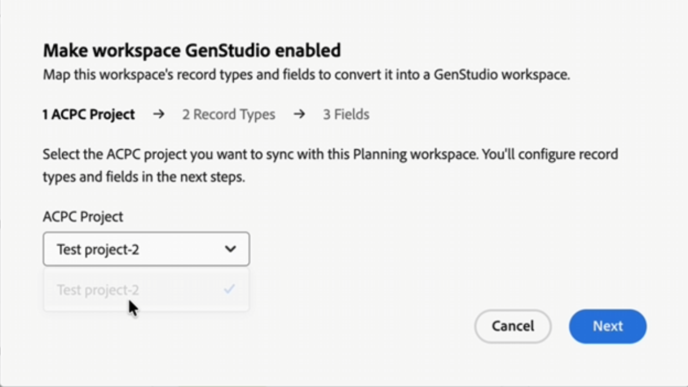

# Abilitare un&#39;area di lavoro di Workfront Planning in GenStudio for Performance Marketing

{{planning-important-intro}}

<!-- THIS IS HIDDEN FROM TOC-->

<!--Iskuhi said "ACPC projects" will be renamed when this will be released but not sure if it has been. Follow up with Syuzanna, Gurgen Mosesyan and possibly Himanshi Kumar - see slack threads -->

Quando la tua azienda acquista anche Adobe GenStudio for Performance Marketing e sei un cliente Adobe Workfront Planning, l’area di lavoro GenStudio è disponibile anche in Workfront Planning.

Se si dispone già di un&#39;area di lavoro Planning in Workfront Planning, è possibile abilitarla per GenStudio for Performance Marketing anziché ricrearne gli stessi dati in GenStudio.

L’abilitazione di un’area di lavoro la collega a un progetto Adobe Could Storage e ne mappa i tipi di record e i campi nell’area di lavoro GenStudio. Dopo aver completato la configurazione, puoi aprire i record dell’area di lavoro in GenStudio.

Devi avere i seguenti:

* Accesso a Workfront Planning e GenStudio for Performance Marketing.
* Un progetto Adobe Cloud Storage per il collegamento all’area di lavoro. L’amministratore dell’organizzazione può crearne una in Adobe Admin Console.

  Per informazioni, consulta [Gestire l&#39;archiviazione Adobe](https://helpx.adobe.com/business/enterprise/manage-storage-assets/manage-storage/manage-adobe-storage.html). <!--ensure this site still works-->

## Requisiti di accesso

+++ Espandi per visualizzare i requisiti di accesso per la funzionalità in questo articolo. 

<table style="table-layout:auto"> 
<col> 
</col> 
<col> 
</col> 
<tbody> 
    <tr> 
<tr> 
</tr>   
<tr> 
   <td role="rowheader">
Pacchetto Adobe Workfront
</td> 
   <td> 

Qualsiasi Workfront o flusso di lavoro e qualsiasi pacchetto Planning
 
Oppure

Qualsiasi pacchetto Planning acquistato come prodotto standalone

</td> 
   <tr> 
<td> 
   
 Prodotti aggiuntivi
 </td> 
   <td> 
   
 Adobe GenStudio for Performance Marketing
</td> 
  </tr>

<tr> 
<td> 
   
 Impostazioni Adobe Admin Console
 </td> 
   <td> 
   
 Devi creare progetti Adobe Storage Cloud in Adobe Admin Console 

Per informazioni, vedere <a href="https://helpx.adobe.com/business/enterprise/manage-storage-assets/manage-storage/projects-in-business-storage.html#project-policies">Gestione progetti</a>

</td> 
  </tr>
  <tr>

<tr> 
   <td role="rowheader">
Licenza di Adobe Workfront
</td> 
   <td>
Standard flusso di lavoro

   </td> 
  </tr> 
  <tr> 
   <td role="rowheader">
Licenza Adobe Planning
</td> 
   <td>
Standard di pianificazione

   </td> 
  </tr>
<tr> 
   <td role="rowheader">
Configurazione del livello di accesso di Adobe Workfront
</td> 
   <td> 
È necessario aggiungere sia un flusso di lavoro che un tipo di licenza Planning al livello di accesso a Workfront quando si dispone sia di un flusso di lavoro che di un pacchetto Planning
   
</td> 
  </tr>

<tr> 
   <td role="rowheader">
Ruoli utente di Adobe GenStudio for Performance Marketing
</td> 
   <td>
<ul><li>Qualsiasi ruolo utente di GenStudio se devi accedere a Campagne, Prodotti e Utenti tipo</li>
   <li>GenSudio System Manager se è necessario accedere ad Activations <!--and Events--></li></ul>
   Per informazioni, vedere <a href="https://experienceleague.adobe.com/en/docs/genstudio-for-performance-marketing/user-guide/intro/user-roles">Ruoli utente e autorizzazioni</a>. 
   

  </td> 
  </tr>   
<tr> 
   <td role="rowheader">
Autorizzazioni sugli oggetti
</td> 
   <td>  
   
In Workfront Planning: 

   <ul>
   <li>
Gestire le autorizzazioni per l’area di lavoro <!--to add new fields or record types to the GenStudio workspace-->
</li>
   <!--
   <li>
Contribute permissions to the GenStudio workspace to add, update, or delete records in the GenStudio workspace
 </li>  
   -->
   </ul>
   <!--
   
No users can remove GenStudio for Performance Marketing record types or fields from the GenStudio workspace in Workfront Planning

   -->
   
In Adobe GenStudio for Performance Marketing: 

   <ul>
   <!--
   <li>
 Any permissions in Adobe GenStudio for Performance Marketing
</li>
   -->
   <li>
 Creare le autorizzazioni in Adobe GenStudio for Performance Marketing per creare elementi
</li></ul>
   </td>  
</tbody> 
</table>

Per informazioni sull&#39;accesso ad Adobe Workfront Planning, vedere [Panoramica dell&#39;accesso ad Adobe Workfront Planning](/help/quicksilver/planning/access/access-overview.md).

Per ulteriori informazioni su Adobe GenStudio for Performance Marketing, consulta [Guida utente di Adobe GenStudio for Performance Marketing](https://experienceleague.adobe.com/it/docs/genstudio-for-performance-marketing/user-guide/home).

+++ 

## Abilitare un&#39;area di lavoro di Workfront Planning in GenStudio

1. In Workfront Planning aprire l&#39;area di lavoro che si desidera abilitare.
1. Fai clic sul menu **Altro**  a destra del nome dell&#39;area di lavoro, quindi fai clic su **Abilita GenStudio**.

   La casella **Imposta come area di lavoro GenStudio** abilitata si apre con i seguenti passaggi:

   1. **Progetto ACPC**: seleziona il **Progetto ACPC** (progetto Adobe Cloud Storage) che desideri sincronizzare con questa area di lavoro, quindi fai clic su **Avanti**. Gli utenti accedono all’area di lavoro in GenStudio tramite questo progetto.

      

   1. **Tipi di record**: associare i tipi di record dell&#39;area di lavoro ai sei tipi di record richiesti da GenStudio:

      * Campagne
      * Prodotti
      * Persone
      * Canali
      * Aree geografiche
      * Attivazioni

      Per ognuno, aprire l&#39;elenco e selezionare il tipo di record Planning corrispondente oppure selezionare **Aggiungi nuovo** per crearlo, quindi fare clic su **Avanti**.

      

   1. **Campi**: mappa i campi per ogni tipo di record. Utilizzare le schede nella parte superiore della finestra di dialogo per spostarsi tra i tipi di record. Per ogni campo, selezionare il campo Planning corrispondente oppure selezionare **Aggiungi nuovo** per creare un campo.

      Ripetere l&#39;impostazione del campo per tutti i tipi di record.

      

   1. Rivedi e risolvi eventuali avvisi.

      Ad esempio, un nuovo campo può diventare il campo principale per il tipo di record oppure un alias di campo già in uso viene rinominato (se disponi già di un campo denominato &quot;Aree&quot;, quello importato potrebbe diventare &quot;Aree 2&quot;).

      La mappatura di un campo **Stato** aggiunge le opzioni richieste.

   1. Fai clic su **Pubblica**.

      Quando l’area di lavoro è abilitata, viene visualizzato un messaggio di conferma. I tipi di record mappati vengono contrassegnati nell&#39;area di lavoro.

      I tipi di record mappati per essere accessibili da GenStudio hanno una nuova icona **Adobe** sulle loro schede.

      

1. Apri GenStudio e seleziona **Campagne**, quindi fai clic sul **progetto ACPC** originariamente configurato per questa installazione nell&#39;angolo inferiore sinistro della schermata. Esaminare i tipi di record e i campi importati.

   >[!TIP]
   >
   >Puoi visualizzare solo i record consentiti dall’iscrizione al progetto Adobe Cloud Storage.
