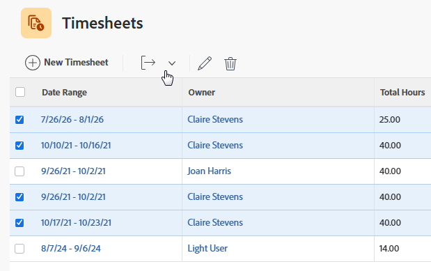

# Esportare un elenco di schede orario

<!--Audited: 8/2024-->

In qualità di responsabile persone o approvatore scheda orario, potrebbe essere necessario scaricare un elenco di schede orario per visualizzare rapidamente le informazioni sulle schede orario delle persone di cui sei responsabile. Per farlo, esporta un elenco di schede orario.

## Requisiti di accesso

+++ Espandi per visualizzare i requisiti di accesso per la funzionalità descritta in questo articolo.

<table style="table-layout:auto"> 
 <col> 
 <col> 
 <tbody> 
  <tr> 
   <td>Pacchetto Adobe Workfront</td> 
   <td> 
Qualsiasi
 </td> 
  </tr> 
  <tr> 
   <td>Licenza di Adobe Workfront</td> 
   <td> 
Chiaro o superiore 

   
Revisione o successiva
 </td> 
  </tr> 
  <tr> 
   <td>Configurazione del livello di accesso</td> 
   <td> 
Visualizzare o accedere ad altre attività e problemi
 </td> 
  </tr> 
  <tr> 
   <td>Autorizzazioni sugli oggetti</td> 
   <td> 
Visualizza o autorizzazioni superiori per attività e problemi
 </td> 
  </tr> 
 </tbody> 
</table>

Per informazioni, consulta [Requisiti di accesso nella documentazione di Workfront](/help/quicksilver/administration-and-setup/add-users/access-levels-and-object-permissions/access-level-requirements-in-documentation.md).

+++

## Esportare un elenco di schede orario

{{step1-to-timesheets}}

Tutte le schede orario a cui hai accesso vengono visualizzate per impostazione predefinita.

1. (Facoltativo) Per aggiornare il filtro nell’elenco delle schede orario, effettua una delle seguenti operazioni:

   * Seleziona **Le mie approvazioni schede orario** nell&#39;angolo superiore destro della pagina per visualizzare solo le schede orario che hai approvato,

     Oppure

     Seleziona **Le mie schede orario** per visualizzare solo le tue schede orario.

     Questa operazione applica i filtri **Le mie approvazioni schede orario** o **Le mie schede orario** all&#39;elenco delle schede orario.

   * Fai clic sull&#39;icona **Filtro**  per applicare un filtro o crearne uno nuovo. Per informazioni sulla creazione o l&#39;aggiornamento dei filtri, vedere [Creare o modificare filtri in Adobe Workfront](../../reports-and-dashboards/reports/reporting-elements/create-filters.md).

   >[!NOTE]
   >
   >Le opzioni Approvazioni schede attività personali e Schede attività personali non vengono visualizzate nella parte superiore dell&#39;elenco delle schede attività o nell&#39;elenco dei filtri se l&#39;amministratore di Workfront o un amministratore di gruppo ha rimosso tali filtri dai controlli elenco nell&#39;area Configura o dal modello di layout. Per ulteriori informazioni, vedere [Personalizzare filtri, visualizzazioni e raggruppamenti utilizzando un modello di layout](../../administration-and-setup/customize-workfront/use-layout-templates/customize-fvg-list-controls-layout-template.md).

1. (Facoltativo) Fai clic sull&#39;icona **Visualizza**  o **Raggruppamento**  per applicare una visualizzazione o un raggruppamento o crearne uno nuovo.

   Per informazioni sulla creazione di filtri, viste o raggruppamenti, vedere i seguenti articoli:

   * [Creare o modificare filtri in Adobe Workfront](../../reports-and-dashboards/reports/reporting-elements/create-filters.md)
   * [Creare o modificare le visualizzazioni in Adobe Workfront](../../reports-and-dashboards/reports/reporting-elements/create-edit-views.md)
   * [Creare raggruppamenti in Adobe Workfront](../../reports-and-dashboards/reports/reporting-elements/create-groupings.md)

1. Seleziona le schede orario da esportare, quindi fai clic sull&#39;icona **Esporta** .

   

1. Seleziona il tipo di file in cui desideri esportare l’elenco delle schede orario tra le seguenti opzioni:

   * PDF - Paesaggio
   * Verticale PDF
   * PDF - Altre dimensioni
   * Excel
   * Excel (xlsx)
   * Delimitato in tabella

   Un elenco di schede orario viene scaricato nel computer nel formato selezionato e include le seguenti informazioni sulla scheda orario:

   * Date Range
   * Nome del proprietario
   * Ore totali
   * Quantità di lavoro straordinario
   * Nomi approvatori
   * Stato
