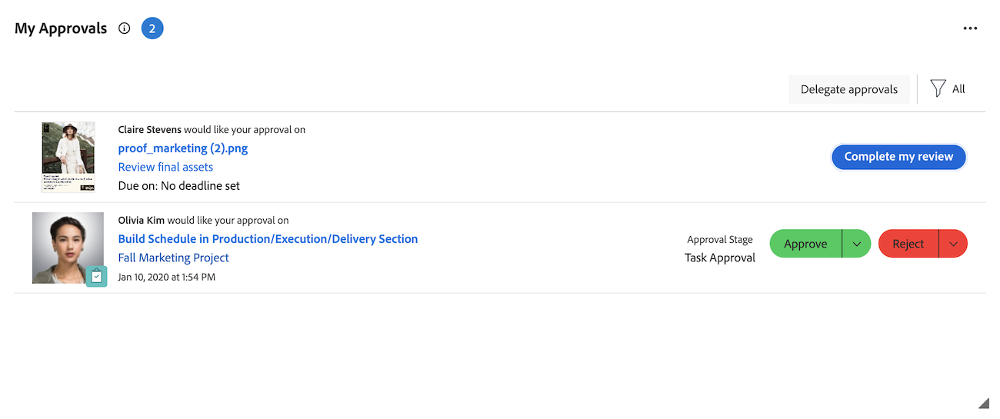

# Gestire le approvazioni con il widget Le mie approvazioni

Il widget Approvazioni personali visualizza tutte le approvazioni in sospeso, assegnate, delegate e inviate in un&#39;unica posizione. Qui puoi filtrare e organizzare le approvazioni, prendere decisioni e delegare le approvazioni in base alle esigenze.

Il widget Approvazioni personali supporta le approvazioni dai seguenti oggetti Workfront:

* Attività
* Problemi
* Progetti
* Documenti
* Bozze
* Pianificazione delle richieste di record
* Schede orario

>[!NOTE]
>
>Se la tua organizzazione utilizza l’archiviazione cloud Adobe, l’approvazione del documento viene visualizzata nel widget solo quando il progetto che contiene il documento è condiviso con te.

## Requisiti di accesso

+++ Espandi per visualizzare i requisiti di accesso per la funzionalità descritta in questo articolo.

<table style="table-layout:auto"> 
 <col> 
 <col> 
 <tbody> 
  <tr> 
   <td role="rowheader">Pacchetto Adobe Workfront</td> 
   <td> 
Qualsiasi
 </td> 
  </tr> 
  <tr> 
   <td role="rowheader">Licenza di Adobe Workfront</td> 
   <td> 
   
Collaboratore o successiva

   
Revisione o successiva
 </td> 
  </tr> 
  <tr> 
   <td role="rowheader">Configurazioni del livello di accesso</td> 
   <td> 
Accesso di visualizzazione o accesso successivo agli oggetti associati alle approvazioni
</td> 
  </tr> 
  <tr> 
   <td role="rowheader">Autorizzazioni sugli oggetti</td> 
   <td> 
Visualizza o autorizzazioni superiori per gli oggetti associati alle approvazioni
</td> 
  </tr> 
 </tbody> 
</table>

Per informazioni, consulta [Requisiti di accesso nella documentazione di Workfront](/help/quicksilver/administration-and-setup/add-users/access-levels-and-object-permissions/access-level-requirements-in-documentation.md).

+++

## Approva il lavoro dal widget Le mie approvazioni

1. Fai clic sull&#39;icona **[!UICONTROL Main Menu]**  nell&#39;angolo superiore destro, quindi fai clic su **[!UICONTROL Home]**.
1. (Condizionale) Fai clic su **Personalizza** per aggiungere il widget **Le mie approvazioni**.
1. (Facoltativo) Regola le opzioni filtro nel widget Approvazioni personali per scegliere quali approvazioni visualizzare. Sono disponibili le seguenti opzioni di filtro:

   | Opzione filtro | Descrizione |
   |--------|-------------|
   | Tutti | Visualizza tutte le approvazioni assegnate all&#39;utente, delegate all&#39;utente da altri utenti e inviate dall&#39;utente. |
   | Le mie approvazioni | Visualizza le approvazioni assegnate all&#39;utente. Questa è l&#39;opzione predefinita. |
   | Approvazioni delegate | Visualizza le approvazioni delegate da altri utenti. |
   | Approvazioni che ho inviato | Visualizza le approvazioni inviate ad altri utenti. |

   >[!NOTE]
   >
   >Le approvazioni assegnate a Ruoli o Gruppi non vengono visualizzate nella Home. Le approvazioni assegnate ai team vengono visualizzate nel widget Approvazioni personali per ogni membro del team.

1. (Condizionale) Fai clic sul menu a discesa **Ordina**, quindi seleziona **Primi** più recenti per visualizzare le approvazioni aggiunte più di recente.

1. (Facoltativo) Fai clic sull&#39;icona Schermo intero  per aprire il widget Approvazioni personali a schermo intero.

1. Seleziona l’elemento in cui desideri prendere una decisione di approvazione.

   

   <!--update screenshot after production release-->

1. Fai clic su una delle opzioni disponibili quando prendi una decisione di approvazione nel pannello a destra. Le seguenti opzioni vengono visualizzate nell&#39;angolo superiore destro della pagina, a seconda del tipo di elemento che si sta approvando:

   <table>
   <tr>
      <td>
      
<strong>Accesso</strong>

      </td>
      <td>
      
<strong>Elementi di lavoro</strong>

      </td>
      <td>
      
<strong>Documenti</strong>

      </td>
      <td>
      
<strong>Bozze</strong>

      </td>
   </tr>
   <tr>
      <td>
       <ul>
      <li>Concedi</li>
      <li>Ignora</li>
      </ul>
      Se necessario, è possibile regolare il livello di accesso nel menu a discesa <b>Modifica accesso</b>.
      </td>
      <td>
         <ul>
         <li>Approvazione</li>
         <li>Rifiuta</li>
         </ul>
      Per lasciare un commento associato alla decisione, fai clic sul menu a discesa nel pulsante di decisione.
      </td>
      <td>
   Assegnato come approvatore
         <ul>
         <li>Approvazione</li>
         <li>Approva con modifiche</li>
         <li>Azioni da intraprendere</li>
         </ul>
   Assegnato come revisore
         <ul>
         <li>Completa la revisione</li>
         </ul>
      Le opzioni in questa colonna si applicano solo alle approvazioni unificate. Le approvazioni di documenti legacy vengono visualizzate come le approvazioni di elementi di lavoro. 
      </td>
      <td>
         <ul>
         <li>Vai alla bozza</li>
         </ul>
         La decisione viene presa nel visualizzatore bozze. Per informazioni sulla revisione di una bozza, vedi <a href="/help/quicksilver/review-and-approve-work/proofing/reviewing-proofs-within-workfront/review-proofs-in-wf.md">Verifica delle bozze in Adobe Workfront</a>.
      </td>
   </tr>
   </table>

## Quando le approvazioni vengono rimosse dal widget

Un&#39;approvazione viene rimossa dal widget Approvazioni personali dopo che hai preso una decisione in merito. Le approvazioni vengono rimosse anche nelle seguenti situazioni:

* **Approvazioni lavoro**: le approvazioni di progetti, attività e problemi vengono rimosse dal widget quando il progetto si trova in uno dei seguenti stati:
  * Completato
  * Morto
  * In sospeso

  >[!NOTE]
  >
  >Se un progetto è in attesa di approvazione, l’approvazione del progetto può comunque essere visualizzata per gli approvatori correnti, ma non per le approvazioni relative ad attività e problemi.

* **Approvazioni documenti legacy**: le approvazioni di documenti legacy vengono rimosse dal widget in base allo stato dell&#39;oggetto a cui il documento è direttamente collegato, non su un oggetto padre. L&#39;approvazione viene rimossa quando l&#39;oggetto si trova in uno dei seguenti stati:
  * Progetto: Completo o Inattivo
  * Attività: Completata
  * Problema: chiuso o uno stato che equivale a chiuso. Ciò include Resolved, Won&#39;t Resolve, Cannot Duplicate e Verified Complete.

* **Approvazioni unificate**: le approvazioni unificate rimangono nel widget indipendentemente dallo stato del progetto, dell&#39;attività o del problema. La loro visibilità è controllata dal flusso di lavoro di approvazione e dalle responsabilità di approvazione in sospeso, pertanto è possibile rimuovere un’approvazione dal widget prima del completamento dell’intero flusso di lavoro.

Gli stati personalizzati seguono la mappatura Equates With (Equivale a), pertanto uno stato che corrisponde a uno qualsiasi degli stati sopra indicati produce lo stesso risultato. L&#39;approvazione può rimanere in sospeso sull&#39;oggetto anche quando viene rimossa dal widget. Per ulteriori informazioni sugli stati personalizzati, vedere [Creare o modificare uno stato](/help/quicksilver/administration-and-setup/customize-workfront/creating-custom-status-and-priority-labels/create-or-edit-a-status.md).
